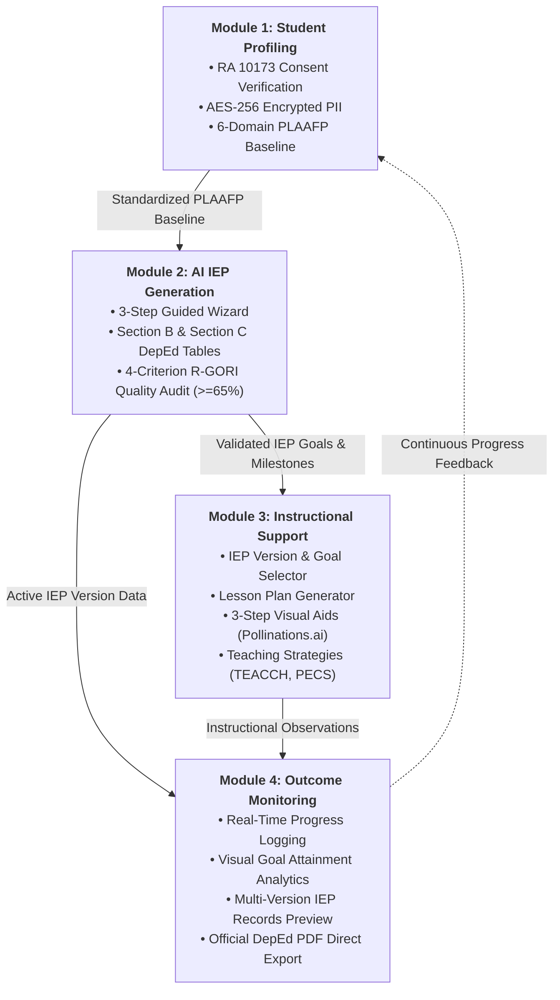

<div align="center">

# 🧠 NeuroPath

**AI-Driven Adaptive Individualized Education Plan (IEP) Generation and Instructional Support System**

*Engineered for Special Education (SPED) Teachers handling Elementary Students with Autism Spectrum Disorder (ASD) in Region VII, Philippines*

[](https://opensource.org/licenses/MIT)
[](https://reactjs.org/)
[](https://vitejs.dev/)
[](https://www.djangoproject.com/)
[](https://www.django-rest-framework.org/)
[](https://www.postgresql.org/)
[](https://supabase.com/)
[](https://ai.google.dev/)
[](https://groq.com/)
[](https://vitest.dev/)
[](https://docs.astral.sh/ruff/)
[](https://www.privacy.gov.ph/data-privacy-act/)

[Mission Overview](#-mission-overview) •
[Live Deployments](#-live-deployments--environments) •
[System Architecture](#-system-architecture) •
[Tech Stack](#%EF%B8%8F-tech-stack) •
[Core Modules](#-system-modules) •
[Security & Privacy](#-security-compliance--pii-encryption-ra-10173) •
[Developer Commands](#-developer-command-reference) •
[Getting Started](#-getting-started) •
[Environment Variables](#-environment-variables) •
[Documentation Suite](#-documentation-suite) •
[Research Context](#-research-context) •
[License](#-license)

---

> *"IEP quality alone accounts for up to 25% of the variance in a student's actual outcomes."*  
> — **Ruble & McGrew, 2013**

</div>

---

## 🛰️ Mission Overview

**NeuroPath** is a full-stack, AI-orchestrated clinical and pedagogical management platform engineered specifically for elementary Special Education (SPED) teachers handling learners with **Autism Spectrum Disorder (ASD)** in **Region VII (Central Visayas), Philippines**.

In Philippine special education, teachers face an administrative paradox: IEP documentation is historically driven by **procedural compliance** rather than **pedagogical efficacy**. Standard documentation systems treat an IEP merely as a static bureaucratic formality once signatures are collected. In practice:
1. Formulating baseline **Present Levels of Academic Achievement and Functional Performance (PLAAFP)** across cognitive, sensory, and behavioral domains is time-consuming and subjective.
2. Translating PLAAFP findings into legally defensible, measurable goals meeting the **Revised IFSP/IEP Goals and Objectives Rating Instrument (R-GORI)** standard is extraordinarily difficult under heavy teaching loads.
3. Converting approved IEP goals into daily classroom instructional materials (localized lesson plans, visual schedules, picture cards, and behavioral supports) requires hours of manual drafting.
4. Tracking continuous student progress across quarterly reporting cycles often lacks quantitative rigor.

**NeuroPath resolves this challenge by providing an end-to-end pedagogical pipeline:**
- **Strict Data Privacy & Minor Protection (RA 10173)** — Mandatory legal guardian consent verification and AES-256 application-layer encryption at rest for sensitive learner PII.
- **AI-Assisted Goal Synthesis Grounded in DepEd Frameworks** — Automated goal synthesis aligned with **DepEd Order No. 021, s. 2020** (*K to 12 Transition Curriculum Framework for Learners with Disabilities*).
- **R-GORI Automated Pedagogical Audit Engine** — Evaluates every synthesized goal across 4 objective criteria (Measurability, Functionality, Generality, and Instructional Context) with transparent score breakdowns targeting $\ge 65\%$ expert compliance.
- **Automated Instructional Translation** — Instantly unpacks IEP goals into 3-month milestone targets, customized lesson plans, 3-step visual aid task sequences with AI-generated picture supports, and evidence-based teaching strategies (TEACCH, PECS, PBIS).
- **Outcome Monitoring & Multi-Version Student Records** — Real-time progress logging, goal attainment analytics via Recharts, and independent version-pairing preview and print-ready PDF export via ReportLab.

---

## 🌐 Live Deployments & Environments

NeuroPath is deployed across cloud hosting providers with automated continuous integration:

| Component | Platform | Environment / Target | URL / Access |
| :--- | :--- | :--- | :--- |
| **Frontend Web Client** | **Vercel** | Production (`main` branch) | [neuro-path-rho.vercel.app](https://neuro-path-rho.vercel.app/) |
| **Backend REST API** | **Render** | Production/Staging (`staging` branch) | Active Cloud Web Service (`/api/`) |
| **Database & Auth Storage** | **Supabase** | Managed PostgreSQL 15 | Cloud PostgreSQL Instance |
| **System Keepalive Cron** | **Cron Monitor** | HTTP `HEAD` / `GET` (`/api/health/`) | 10-min keepalive prevents Render cold-starts |

### Branching Strategy
- **`main`** — Production-ready release branch; automatically triggers Vercel frontend deployments.
- **`staging`** — Production staging environment; automatically triggers Render backend builds, static file collection, and database migrations.
- **`development`** — Active integration branch for new features, bugfixes, and audited pull requests.

---

## 🏗️ System Architecture

Below is the verified structural directory schematic of the NeuroPath repository:

```text
📦 NeuroPath
├── 📄 docker-compose.yml                      # Local development multi-container orchestration
├── 📄 docker-compose.prod.yml                 # Production multi-container orchestration
├── 📄 README.md                               # Project documentation & reference manual
├── 📄 LICENSE                                 # MIT Open-Source License
├── 📄 Logo.png                                # Official NeuroPath brand logo asset
│
├── 📂 docs                                    # Technical documentation & research reports
│   ├── 📂 rag                                 # RAG system specs, DepEd frameworks & query pipeline
│   ├── 📂 security                            # RA 10173 AES-256 PII encryption & key rotation guide
│   ├── 📂 superpowers                         # Architecture specs & feature execution plans
│   ├── 📂 tables                              # Change history, RTM, defect logs, & test summaries
│   ├── 📄 student_records_version_selection_guide.md # SPED teacher guide for multi-version IEP preview
│   └── 📄 DOC_CONSISTENCY_AUDIT_FINDINGS.md   # Documentation consistency audit report
│
├── 📂 neuropath-backend                       # Django REST Framework Backend Core
│   ├── 📄 manage.py                           # Django CLI management entry point
│   ├── 📄 requirements.txt                    # Production Python dependencies
│   ├── 📄 requirements-dev.txt                # Development, test, & lint dependencies
│   ├── 📄 Dockerfile                          # Container specification for backend runtime
│   │
│   ├── 📂 neuropath_core                      # Global Django configuration & root endpoints
│   │   ├── 📄 settings.py                     # App settings, DB connections, CORS, & security config
│   │   ├── 📄 urls.py                         # Master URL router (health check, users, IEP, resources, tracking)
│   │   ├── 📄 views.py                        # Health check view (/api/health/ supporting GET & HEAD)
│   │   ├── 📄 wsgi.py                         # Production WSGI application gateway
│   │   └── 📄 asgi.py                         # Async ASGI application gateway
│   │
│   ├── 📂 users                               # Module 1: Teacher Authentication & Student Profiles
│   │   ├── 📄 models.py                       # Teacher & StudentProfile models (RA 10173 consent & PII)
│   │   ├── 📄 fields.py                       # EncryptedCharField & EncryptedTextField (AES-256 Fernet)
│   │   ├── 📄 utils.py                        # PII cipher engine, placeholder formatters, & Fernet helpers
│   │   ├── 📄 serializers.py                  # Teacher auth & student profile validation serializers
│   │   ├── 📄 views.py                        # Auth, profile CRUD, consent certificate PDF generation
│   │   ├── 📄 urls.py                         # /api/users/ endpoints
│   │   └── 📂 management/commands             # reencrypt_student_pii (zero-downtime key rotation)
│   │
│   ├── 📂 iep_management                      # Module 2: IEP Generation & R-GORI Pedagogical Audit
│   │   ├── 📄 models.py                       # IEPModel (Section B), IEPGoal (Section C), IEPObjectiveRow
│   │   ├── 📄 ai_engine.py                    # Multi-tier LLM router (Gemini, Groq, OpenRouter, Ollama)
│   │   ├── 📄 rgori_service.py                # 4-criterion R-GORI evaluation engine (ABCD heuristics)
│   │   ├── 📄 privacy_utils.py                # Ephemeral regex PII scrubber for prompt protection
│   │   ├── 📄 huggingface_service.py          # Hugging Face Inference API client
│   │   ├── 📄 services.py                     # ReportLab DepEd-standard IEP PDF export engine
│   │   ├── 📄 serializers.py                  # IEP and objective row serializers
│   │   ├── 📄 views.py                        # IEP generation, goal synthesis, edit, and PDF export views
│   │   ├── 📄 urls.py                         # /api/iep/ endpoints
│   │   └── 📂 tests                           # Exhaustive unit test suite for AI, R-GORI, & sync
│   │
│   ├── 📂 resources                           # Module 3: Instructional Support & Translation
│   │   ├── 📄 models.py                       # LessonPlan, VisualAid (3-step tasks), TeachingStrategy
│   │   ├── 📄 services.py                     # ReportLab export engine for lesson plans & strategies
│   │   ├── 📄 permissions.py                  # Teacher resource ownership validation
│   │   ├── 📄 serializers.py                  # Resource CRUD & generation serializers
│   │   ├── 📄 views.py                        # Lesson plan, visual aid, and teaching strategy controllers
│   │   └── 📄 urls.py                         # /api/resources/ endpoints
│   │
│   └── 📂 tracking                            # Module 4: Outcome Monitoring & Progress Analytics
│       ├── 📄 models.py                       # StudentProgress, ProgressReport, SecurityLog, ProcessingLog
│       ├── 📄 permissions.py                  # Data isolation permissions per teacher
│       ├── 📄 serializers.py                  # Progress logging and analytics serializers
│       ├── 📄 views.py                        # Progress dashboard, analytics aggregation, recent activity
│       └── 📄 urls.py                         # /api/tracking/ endpoints
│
└── 📂 neuropath-frontend                      # React 18 + Vite Web Client Interface
    ├── 📄 package.json                        # Frontend dependencies, Vitest, & build scripts
    ├── 📄 vite.config.js                      # Vite bundler, path aliases, & test config
    ├── 📄 eslint.config.js                    # ESLint 9 flat configuration
    │
    └── 📂 src
        ├── 📄 App.jsx                         # Master routing architecture & layout wrapping
        ├── 📄 main.jsx                        # Application root DOM mount point
        ├── 📄 queryClient.js                  # TanStack Query client & cache configuration
        ├── 📄 index.css                       # Global design tokens, typography, & base styles
        ├── 📄 App.css                         # App-wide structural styles & grid layout
        │
        ├── 📂 api                             # Unified API client & axios/fetch interceptors
        │   └── 📄 client.js                   # Authenticated client with automatic Bearer token injection
        │
        ├── 📂 assets                          # Branding assets, logo, hero images, & SVG icons
        │
        ├── 📂 components                      # Reusable UI primitives & functional modals
        │   ├── 📂 layout                      # Sidebar, Topbar, Breadcrumbs, SkipLink, LogoutModal
        │   ├── 📂 session                     # SessionTimeoutManager, SessionTimeoutModal
        │   ├── 📂 ui                          # Button, Card, Badge, Callout, Modal, Tabs, Toast
        │   ├── 📄 Ra10173ConsentModal.jsx     # Mandatory parental consent acquisition dialog
        │   ├── 📄 RecordProgressModal.jsx     # Real-time behavioral & goal score logging modal
        │   ├── 📄 SignaturePadModal.jsx       # Digital signature canvas for IEP sign-offs
        │   ├── 📄 TeacherTutorialModal.jsx    # Guided introductory walkthrough for new SPED teachers
        │   └── 📄 StudentShimmer.jsx          # Accessible skeleton loading state
        │
        ├── 📂 context                         # Application state providers
        │   ├── 📄 AuthContext.jsx             # Teacher session, user details, and login/logout state
        │   ├── 📄 ToastContext.jsx            # Toast notification dispatching
        │   └── 📄 UnsavedChangesContext.jsx   # Form dirtiness guard preventing accidental navigation
        │
        ├── 📂 pages                           # Route-level view controllers
        │   ├── 📄 landingPage.jsx             # Public landing page with feature showcase & progress demo
        │   ├── 📄 loginPage.jsx               # Teacher login with session recovery
        │   ├── 📄 registerPage.jsx            # Teacher registration with password strength meter
        │   ├── 📄 Overview.jsx                # Teacher dashboard with quick stats & recent student feed
        │   ├── 📄 UserProfilePage.jsx         # Teacher profile & school assignment management
        │   ├── 📄 CreateStudentProfile.jsx    # Module 1: Comprehensive student profiling & consent entry
        │   ├── 📄 IepGenerationPage.jsx       # Module 2: Sequential 3-step IEP generation wizard
        │   ├── 📄 ManageLessonPlans.jsx       # Module 3: IEP goal-linked lesson plan generator & library
        │   ├── 📄 ManageVisualAids.jsx        # Module 3: 3-step visual schedule & picture card generator
        │   ├── 📄 ManageTeachingStrategies.jsx# Module 3: Evidence-based ASD strategy generator & library
        │   ├── 📄 ViewStudentRecords.jsx      # Module 4: Multi-version IEP preview & official PDF export
        │   ├── 📄 ViewProgressDashboard.jsx   # Module 4: Progress analytics, charts, & data export
        │   ├── 📄 NotFoundPage.jsx            # 404 error page with route recovery
        │   └── 📂 StudentProfiling            # Student directory, detailed cards, & profile editor
        │
        ├── 📂 utils                           # Date formatters, difficulty parsers, & password checkers
        └── 📂 test                            # Vitest test utilities, mock handlers, & a11y helpers
```

---

## ⚙️ Tech Stack

| Domain | Technology | Version | Purpose & Rationale |
| :--- | :--- | :--- | :--- |
| **Frontend Framework** | **React** | `18.3.1` | Declarative, component-driven UI architecture |
| **Bundler & Dev Server** | **Vite** | `5.4.2` | Fast HMR, Rollup production bundling, and optimized assets |
| **Routing** | **React Router DOM** | `6.26.1` | Client-side nested routing and protected route guards |
| **Async State & Caching** | **TanStack Query** | `5.56.2` | Cache invalidation, deduplication, and optimistic updates |
| **Data Visualization** | **Recharts** | `2.12.7` | SVG-based responsive analytics and goal trajectory charts |
| **Icons & Micro-animations** | **Lucide React / Canvas Confetti** | `^0.441.0` | Accessible iconography and visual reward micro-interactions |
| **Frontend Testing** | **Vitest / Testing Library** | `^2.1.1` | Fast unit/integration test runner with DOM simulation |
| **Backend Framework** | **Django** | `6.0.5` | Secure, scalable Python web application framework |
| **REST API Engine** | **Django REST Framework (DRF)** | `3.17.1` | Serializers, ViewSets, and Token-based authentication |
| **Language Runtime** | **Python** | `3.11+ / 3.13` | High-level language supporting modern AI/ML tooling |
| **Database** | **PostgreSQL (Supabase)** | `15.1` | ACID-compliant relational database with JSONB indexing |
| **Data Privacy & Encryption** | **Cryptography (Fernet)** | `AES-256` | Application-layer PII encryption complying with RA 10173 |
| **Document Generation** | **ReportLab** | `4.4.1` | High-fidelity, print-ready DepEd-standard PDF generation |
| **Primary AI Orchestration** | **Google Gemini API** | `gemini-1.5-flash` | Fast, high-context LLM for IEP goal synthesis |
| **Secondary AI Orchestration**| **Groq Cloud API** | `llama-3.3-70b` | Ultra-low latency Llama-3.3 fallback provider |
| **Local / Edge AI Engine** | **Ollama** | `llama3.2:3b` | Offline local LLM support for network-isolated classrooms |
| **Image Generation** | **Pollinations.ai** | Multi-model | AI picture card synthesis for visual communication aids |
| **Python Code Quality** | **Ruff** | `0.16.9` | Ultra-fast PEP8 linter and code formatter |
| **Production Server** | **Gunicorn / WhiteNoise** | `23.0.0` | WSGI production server with optimized static file serving |

---

## 🧩 System Modules

NeuroPath is designed around four tightly integrated pedagogical modules:



---

### Module 1 — Student Profiling & Data Privacy (RA 10173)
> *Standardizes baseline PLAAFP observations into an encrypted, AI-ready profile.*

The foundation of every defensible IEP is an accurate, comprehensive baseline. Module 1 enforces structured data entry while rigorously safeguarding minor learner privacy:
- **Mandatory RA 10173 Consent Gating** — Prevents profile creation until explicit parental or legal guardian consent is confirmed via [`Ra10173ConsentModal.jsx`](file:///C:/Users/John%20Lyster/orca/NeuroPath/neuropath-frontend/src/components/Ra10173ConsentModal.jsx). Teachers can also download an official printable Consent Certificate PDF.
- **Comprehensive Assessment Domains** — Captures Present Levels across Academic Performance, Communication/Language, Social-Emotional, Motor Skills, Cognitive Abilities, and Sensory/Behavioral Quirks.
- **Application-Layer AES-256 Encryption** — Protects student names, guardian identities, medical diagnoses, and clinical assessment results at rest using Fernet ciphers ([`users/fields.py`](file:///C:/Users/John%20Lyster/orca/NeuroPath/neuropath-backend/users/fields.py)).
- **Automated AI Insights** — Instantly summarizes baseline data into pedagogical strengths, priority intervention areas, and learning barriers.

---

### Module 2 — AI-Based IEP Generation & R-GORI Quality Scoring
> *Synthesizes legally defensible IEP goals aligned with DepEd Order No. 021, s. 2020.*

Module 2 transforms unstructured baseline observations into a complete, DepEd-compliant IEP through a guided 3-step workflow:
1. **Step 1: Baseline Review & Insights** — Confirms student PLAAFP data, accommodations, and AI-identified priority focus areas.
2. **Step 2: Section B Macro-Environment Factors** — Structured mapping of Program Type (Graded vs. Non-Graded), Specific Difficulties, Learning Barriers, Barrier Qualifiers, Learning Facilitators, Facilitator Qualifiers, and Enabling Accommodations.
3. **Step 3: Section C Learner Goals & Objective Rows** — Generates complete annual goals paired with **3-Month Milestone Progressions** (Month 1, Month 2, Month 3 targets), Enroute K-12 Objectives, Interventions/Procedures, Session Timelines, and Responsible Individuals.

#### R-GORI Pedagogical Audit Engine
Every synthesized goal is evaluated against the **Revised IFSP/IEP Goals and Objectives Rating Instrument (R-GORI)** across four distinct criteria (25 points each, 100 points total):

| Criterion | Max Points | Evaluation Heuristics & Pedagogical Standards |
| :--- | :---: | :--- |
| **1. Measurability** | **25 pts** | Evaluates observable action verbs (e.g. *identifies, communicates, matches*) vs. non-observable verbs (*understands, learns*). Scored on quantifiable criteria, accuracy percentages, trial ratios, and multi-session endurance. |
| **2. Functionality** | **25 pts** | Assesses how directly the target behavior facilitates active participation, communication, and independence in daily school, classroom, and community routines. |
| **3. Generality** | **25 pts** | Verifies that the skill represents a generalizable competency that transfers across multiple settings, materials, teachers, and peer interactions. |
| **4. Instructional Context** | **25 pts** | Confirms the goal is expressed in clean, jargon-free pedagogical language directly teachable by general education teachers, SPED aides, and parents. |

- **Threshold Benchmark:** Goals scoring $\ge 65\%$ are certified as **IEP Ready** or **Exemplary**.
- **Multi-Tier AI Resilience:** If an external LLM (Gemini/Groq) experiences rate-limiting (HTTP 429) or network latency, the backend seamlessly routes through fallback providers and ABCD heuristic fallbacks, ensuring zero user-facing downtime.

---

### Module 3 — Instructional Support & Resource Translation
> *Translates approved IEP goals into localized, print-ready daily classroom resources.*

Module 3 closes the gap between IEP documentation and classroom execution through a streamlined 3-step resource selection pipeline:
1. **Step 1: Select Student & IEP Version** — Features an enlarged version selection card showing the active version, creation date, and total goals, with a **"View Full Version"** modal that previews all associated goals and quarterly milestones.
2. **Step 2: Select Target IEP Goal** — Choose the specific annual goal to target for lesson planning, visual scheduling, or instructional intervention.
3. **Step 3: Generate & Manage Classroom Resources**:
   - **Adaptive Lesson Plans** — Generates structured lesson plans containing learning objectives, materials, step-by-step procedures, guided practice, accommodations, and assessment rubrics.
   - **3-Step Visual Aids** — Unpacks complex skills into 3-step sequence task analyses (e.g., *Step 1: Get soap -> Step 2: Wash hands -> Step 3: Dry with towel*) with custom image cards rendered via Pollinations.ai.
   - **Evidence-Based Teaching Strategies** — Generates classroom-tested strategies grounded in TEACCH, PECS, PBIS, sensory regulation, and prompt-fading techniques.
- **One-Click PDF Export:** Every resource can be printed or exported as an official, branded PDF using ReportLab with consistent NeuroPath design tokens.

---

### Module 4 — Outcome Monitoring, Analytics & Student Records
> *Aggregates daily performance logs into visual learning analytics and multi-version student archives.*

- **Interactive Progress Dashboard** — Visualizes student growth trajectories, average mastery rates, and goal attainment distributions using Recharts.
- **Real-Time Progress Logging** — The [`RecordProgressModal.jsx`](file:///C:/Users/John%20Lyster/orca/NeuroPath/neuropath-frontend/src/components/RecordProgressModal.jsx) enables teachers to log percentage performance scores, session notes, behavioral tallies, and qualitative observations in seconds.
- **Multi-Version Student Records Preview** — Teachers can independently select which **Section B version** (Difficulties & Accommodations) and **Section C version** (Learner Goals & Milestones) to display on-screen and compile into the official PDF export.
- **CSV Data Export** — Allows teachers to export historical progress data for regional DepEd reporting, parent-teacher conferences, and multidisciplinary IEP committee reviews.

---

## 🔒 Security, Compliance & PII Encryption (RA 10173)

NeuroPath adheres to the **Republic Act 10173 (Data Privacy Act of 2012)** governing the processing of sensitive personal information and educational records of minors:

1. **Application-Layer AES-256 Fernet Encryption:**
   - Sensitive database columns (`name`, `guardian_name`, `asdBackground`, `diagnosis`, `assessmentResult`) are encrypted at rest using AES-256 ciphers before reaching the PostgreSQL database.
   - The cipher engine ([`users/utils.py`](file:///C:/Users/John%20Lyster/orca/NeuroPath/neuropath-backend/users/utils.py)) traps decryption mismatches and returns an anonymized placeholder (`[Encrypted Student #<id>]`), preventing raw `gAAAAA...` ciphertext tokens from leaking into frontend UI views or API JSON responses.
2. **Zero-Downtime Key Rotation:**
   - Supports key rotation using `STUDENT_PII_FALLBACK_ENCRYPTION_KEYS`.
   - The Django management command `python manage.py reencrypt_student_pii` decrypts records with previous keys and re-encrypts them under the active key without downtime.
3. **Session Inactivity Guard:**
   - Frontend [`SessionTimeoutManager.jsx`](file:///C:/Users/John%20Lyster/orca/NeuroPath/neuropath-frontend/src/components/session/SessionTimeoutManager.jsx) monitors user activity and automatically prompts for re-authentication after inactivity, protecting shared school computers.
4. **Teacher Data Isolation (Multi-Tenancy):**
   - All student profiles, IEP documents, lesson plans, and progress logs are scoped to the authenticated teacher's account via DRF permissions.

---

## 💻 Developer Command Reference

### Frontend Commands ([`neuropath-frontend/package.json`](file:///C:/Users/John%20Lyster/orca/NeuroPath/neuropath-frontend/package.json))
Run inside `neuropath-frontend/`:

```powershell
cd neuropath-frontend

# Run all unit and integration tests (single CI run)
npm run test           # or: npx vitest run

# Run tests in interactive watch mode
npm run test:watch     # or: npx vitest

# Run ESLint static code analysis
npm run lint           # or: npx eslint .

# Automatically fix autofixable ESLint errors
npx eslint . --fix

# Build production bundle with type validation
npm run build

# Preview production build locally
npm run preview

# Start local development server with Hot Module Reloading
npm run dev
```

### Backend Commands ([`neuropath-backend/manage.py`](file:///C:/Users/John%20Lyster/orca/NeuroPath/neuropath-backend/manage.py))
Run inside `neuropath-backend/` with the virtual environment activated:

```powershell
cd neuropath-backend
.\venv\Scripts\Activate.ps1    # On Windows PowerShell
# source venv/bin/activate     # On macOS / Linux

# Run all Django unit tests with verbose logs
python manage.py test -v 2

# Run tests for a specific application
python manage.py test iep_management -v 2
python manage.py test users -v 2
python manage.py test tracking -v 2

# Run Python linter checks (Ruff)
python -m ruff check .

# Automatically fix linting and import issues
python -m ruff check --fix .

# Verify PEP8 code formatting
python -m ruff format --check .

# Standard system integrity check
python manage.py check

# Production security and deployment check
python manage.py check --deploy

# Check database migration status
python manage.py showmigrations

# Verify no uncreated migrations exist (ideal for CI)
python manage.py makemigrations --dry-run --check

# Generate new database migrations
python manage.py makemigrations

# Apply pending database migrations
python manage.py migrate

# Rotate and re-encrypt student PII (RA 10173)
python manage.py reencrypt_student_pii --dry-run --old-key "<old-key>"
```

### 🚀 All-in-One Pre-Deployment Verification
To verify the complete frontend and backend test, lint, and build suites from the repository root:

```powershell
# Windows PowerShell (from C:\Users\John Lyster\orca\NeuroPath):
npm --prefix neuropath-frontend run lint; `
npm --prefix neuropath-frontend run test; `
npm --prefix neuropath-frontend run build; `
.\neuropath-backend\venv\Scripts\python.exe -m ruff check neuropath-backend; `
.\neuropath-backend\venv\Scripts\python.exe neuropath-backend\manage.py makemigrations --dry-run --check; `
.\neuropath-backend\venv\Scripts\python.exe neuropath-backend\manage.py check; `
.\neuropath-backend\venv\Scripts\python.exe neuropath-backend\manage.py test -v 2
```

---

## 🚀 Getting Started

### Prerequisites
- **Python** (v3.11 or v3.13) and **pip**
- **Node.js** (v18.0.0 or v20.x+) and **npm**
- **PostgreSQL 15+** or a **Supabase** account (Free tier works perfectly)
- **API Keys** for Google Gemini or Groq (for AI IEP generation)
- Modern web browser (Chrome, Edge, Firefox, Safari)

---

### Method A: Local Native Setup

#### 1. Clone the Repository
```bash
git clone https://github.com/YourUsername/NeuroPath.git
cd NeuroPath
```

#### 2. Configure Backend
```bash
cd neuropath-backend
python -m venv venv

# Windows
venv\Scripts\activate
# macOS / Linux
source venv/bin/activate

# Install dependencies
pip install -r requirements.txt

# Configure environment variables
cp .env.example .env
# Edit .env and enter your DATABASE, GEMINI_API_KEY, and Fernet encryption key

# Apply migrations & create admin account
python manage.py migrate
python manage.py createsuperuser

# Start backend server
python manage.py runserver
# API running at http://localhost:8000
```

#### 3. Configure Frontend
Open a new terminal window:
```bash
cd neuropath-frontend

# Install dependencies
npm install

# Configure environment variables
cp .env.example .env
# Ensure VITE_API_URL=http://localhost:8000/api

# Launch development server
npm run dev
# Frontend interface running at http://localhost:5173
```

---

### Method B: Docker Multi-Container Setup

To launch the complete stack (PostgreSQL database, Django backend, and React frontend) in isolated Docker containers:

```bash
# Build and run all services
docker-compose up --build

# Run in detached background mode
docker-compose up -d

# Stop all containers
docker-compose down
```

Services will be accessible at:
- **Frontend:** `http://localhost:5173`
- **Backend API:** `http://localhost:8000/api/`
- **Django Admin:** `http://localhost:8000/admin/`

---

## 🔐 Environment Variables

### Backend Configuration (`neuropath-backend/.env`)

```env
# =====================================================================
# DJANGO CORE & SECURITY SETTINGS
# =====================================================================
SECRET_KEY=django-insecure-your-secret-key-here
DEBUG=True

# Application-layer AES-256 Fernet key for student PII (RA 10173).
# Generate via: python -c "from cryptography.fernet import Fernet; print(Fernet.generate_key().decode())"
STUDENT_PII_ENCRYPTION_KEY=your-shared-fernet-key-here
# Optional fallback keys for zero-downtime key rotation:
# STUDENT_PII_FALLBACK_ENCRYPTION_KEYS=key1,key2

# =====================================================================
# DATABASE CONFIGURATION (PostgreSQL / Supabase)
# =====================================================================
DB_ENGINE=django.db.backends.postgresql
DB_NAME=postgres
DB_USER=postgres
DB_PASSWORD=your-database-password
DB_HOST=db.your-project-ref.supabase.co
DB_PORT=5432

# =====================================================================
# NETWORK SECURITY, HOSTS & CORS
# =====================================================================
ALLOWED_HOSTS=localhost,127.0.0.1,neuropath-backend.onrender.com
CORS_ALLOWED_ORIGINS=http://localhost:5173,https://neuro-path-rho.vercel.app
CSRF_TRUSTED_ORIGINS=http://localhost:5173,https://neuro-path-rho.vercel.app

# =====================================================================
# ARTIFICIAL INTELLIGENCE ORCHESTRATION KEYS
# =====================================================================
GEMINI_API_KEY=your-google-gemini-api-key
GROQ_API_KEY=your-groq-cloud-api-key
OPENROUTER_API_KEY=your-openrouter-key-optional
HF_TOKEN=your-huggingface-token-optional
OLLAMA_HOST=http://localhost:11434
```

### Frontend Configuration (`neuropath-frontend/.env`)

```env
# Base URL pointing to the Django REST API
VITE_API_URL=http://localhost:8000/api

# Feature toggles
VITE_ENABLE_PDF_EXPORT=true
VITE_ENABLE_VISUAL_AIDS=true
VITE_ENABLE_ANALYTICS_DASHBOARD=true
```

> [!CAUTION]
> Never expose backend secrets (`SECRET_KEY`, `DB_PASSWORD`, `GEMINI_API_KEY`, `GROQ_API_KEY`, or `STUDENT_PII_ENCRYPTION_KEY`) in the frontend `.env` file. Frontend environment variables prefixed with `VITE_` are bundled into the public client assets.

---

## 📚 Documentation Suite

Comprehensive technical specifications, design documents, and research guides are maintained in the repository:

| Document | File Path | Focus & Contents |
| :--- | :--- | :--- |
| **SPED Version Selection Guide** | [`docs/student_records_version_selection_guide.md`](file:///C:/Users/John%20Lyster/orca/NeuroPath/docs/student_records_version_selection_guide.md) | Teacher guide for selecting Section B and C versions in Student Records |
| **RA 10173 Encryption Guide** | [`docs/security/pii_encryption_guide.md`](file:///C:/Users/John%20Lyster/orca/NeuroPath/docs/security/pii_encryption_guide.md) | AES-256 Fernet architecture, key derivation, and rotation commands |
| **RAG System Architecture** | [`docs/rag/architecture.md`](file:///C:/Users/John%20Lyster/orca/NeuroPath/docs/rag/architecture.md) | Retrieval-Augmented Generation design, vector search, and embedding models |
| **DepEd ASD Frameworks** | [`docs/rag/deped_asd_frameworks.md`](file:///C:/Users/John%20Lyster/orca/NeuroPath/docs/rag/deped_asd_frameworks.md) | DepEd Order 21 s. 2020 domain taxonomies, ASD evidence-based practices |
| **Pedagogical Query Pipeline** | [`docs/rag/query_pipeline.md`](file:///C:/Users/John%20Lyster/orca/NeuroPath/docs/rag/query_pipeline.md) | Metadata filtering, dynamic prompt injection, and R-GORI repair loops |
| **Third-Party AI Services** | [`docs/rag/third_party_services.md`](file:///C:/Users/John%20Lyster/orca/NeuroPath/docs/rag/third_party_services.md) | LLM routing tiers, zero data retention (ZDR), and privacy boundaries |
| **Requirements Traceability Matrix**| [`docs/tables/table2_traceability_matrix.csv`](file:///C:/Users/John%20Lyster/orca/NeuroPath/docs/tables/table2_traceability_matrix.csv) | End-to-end traceability mapping functional requirements to code & tests |
| **Defect Log** | [`docs/tables/table3_defect_log.csv`](file:///C:/Users/John%20Lyster/orca/NeuroPath/docs/tables/table3_defect_log.csv) | Tracked software defects, root causes, remediations, and verification tests |
| **Test Summary Report** | [`docs/tables/table4_test_summary.csv`](file:///C:/Users/John%20Lyster/orca/NeuroPath/docs/tables/table4_test_summary.csv) | Test execution summaries, pass/fail metrics, and coverage records |

---

## 🔬 Research Context & Capstone Information

NeuroPath is developed as an academic Capstone project in Software Engineering and Special Education technology:

- **Capstone Team Code:** `cs342-14`
- **Target Population:** Elementary Special Education (SPED) teachers handling learners with Autism Spectrum Disorder (ASD) in Region VII (Central Visayas), Philippines.
- **Regulatory Frameworks:** DepEd Order No. 021, s. 2020 (*Policy Guidelines on the Adoption of the K to 12 Transition Curriculum Framework for Learners with Disabilities*) & Republic Act No. 10173 (*Data Privacy Act of 2012*).

### Empirical Research Questions & Evaluation Benchmarks

| Research Metric | Evaluation Method | Target Benchmark |
| :--- | :--- | :---: |
| **IEP Pedagogical Quality** | Blind peer review evaluated via R-GORI | $\ge 65\%$ expert agreement |
| **PLAAFP Formatting Accuracy** | Automated error detection across 6 developmental domains | $\le 5\%$ error rate |
| **Lesson Plan Data Integration** | Parameter translation from IEP goals to lesson plan templates | $\ge 95\%$ formatting success |
| **Data Retrieval Accuracy** | Automated API integration and query response validation | $\ge 85\%$ retrieval precision |
| **System Usability** | System Usability Scale (SUS) standardized questionnaire | $\ge 70$ (Good / Acceptable) |
| **Instructional Planning Time** | Pre/post teacher time-motion study on daily resource preparation | $\ge 20\%$ time reduction |

---

## 🗺️ Project Roadmap & Current Status

- [x] **Sprint 1 — Student Profiling & Data Privacy** (RA 10173 consent gating, AES-256 Fernet PII encryption, 6-domain PLAAFP data collection, Section A Learner Profile).
- [x] **Sprint 2 — AI-Based IEP Generation** (Guided 3-step wizard, Section B macro-environmental factors, Section C goals with 3-month milestone progressions, 4-criterion R-GORI audit engine $\ge 65\%$, multi-tier LLM failover).
- [x] **Sprint 3 — Instructional Support & Resource Translation** (IEP Version selector with "View Full Version" modal, target goal selection, adaptive lesson plans, 3-step visual schedules with Pollinations.ai, evidence-based strategies, ReportLab PDF export).
- [x] **Sprint 4 — Outcome Monitoring & Student Records** (Progress dashboard with Recharts, interactive behavioral and goal score logging, multi-version Section B and C pairing preview, CSV export).
- [x] **Production Deployment & Hardening** (Vercel frontend deployment, Render backend deployment with automated migrations, zero-byte `/api/health/` keepalive cron, WCAG accessibility improvements, TanStack Query cache deduplication).
- [ ] **Field Pilot Testing** (Live pilot study with elementary SPED teachers in Region VII public elementary schools).

---

## 🤝 Contributing

Contributions, code reviews, and feedback from advisers, teachers, and developers are welcome:

1. Fork the repository
2. Create your feature branch: `git checkout -b feature/your-feature-name`
3. Commit your changes with clear semantic messages: `git commit -m 'feat: add your feature'`
4. Ensure tests and linters pass: `npm test` and `python manage.py test`
5. Push to your branch: `git push origin feature/your-feature-name`
6. Open a Pull Request targeting `development`

---

## 📄 License

This project is licensed under the **MIT License** — see the [LICENSE](LICENSE) file for complete details.

---

<div align="center">

**NeuroPath** — *Bridging the Gap Between Documentation and Genuine Learning*  
Built with purpose for Philippine SPED educators and the extraordinary children they guide. 🇵🇭  
**Team `cs342-14`**

</div>
